# Diagrammes de sequence AuditFlow

Ce document decrit les principaux flux visibles dans l'application actuelle.
Les diagrammes sont exprimes en Mermaid pour pouvoir etre visualises dans GitHub
ou dans tout editeur compatible.

## 1. Authentification et ouverture de session

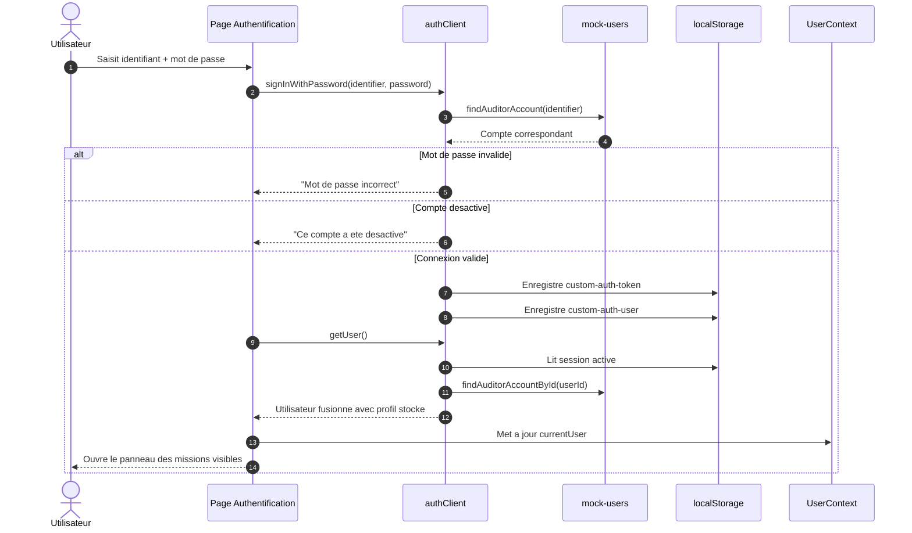

## 2. Selection d'une mission apres connexion

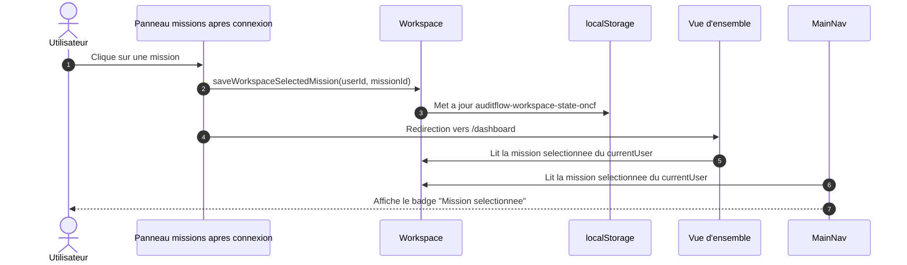

## 3. Consultation rapide et selection officielle d'une mission

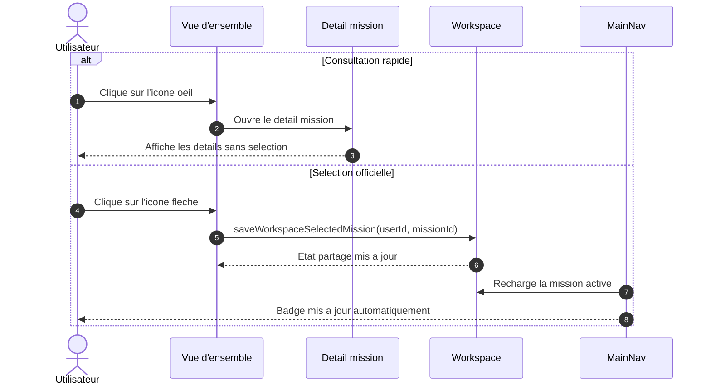

## 4. Creation d'une mission

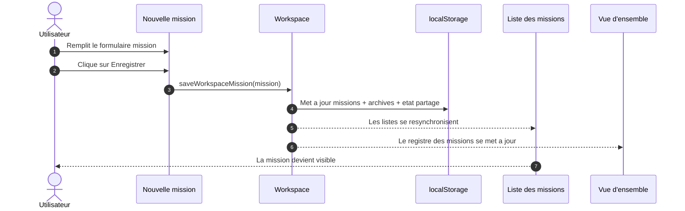

## 5. Phase d'etude - edition et sauvegarde

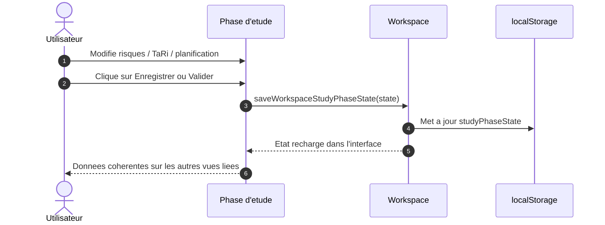

## 6. Suivi - creation d'une recommandation

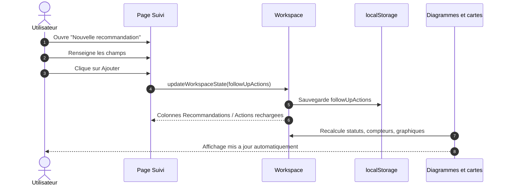

## 7. Suivi - glisser/deposer d'une recommandation ou d'une action

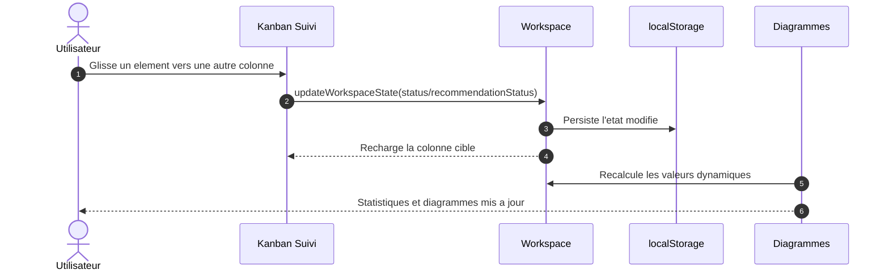

## 8. Gestion du personnel - creation d'un compte

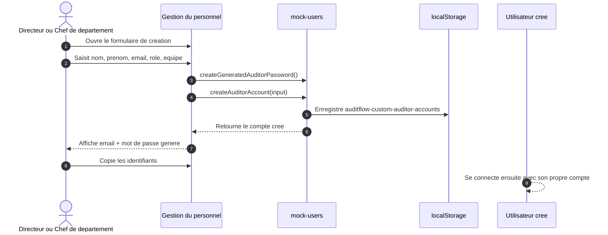

## 9. Profil utilisateur

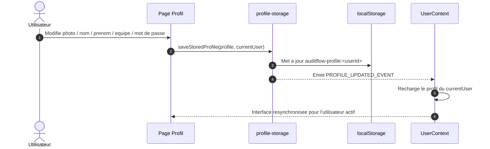

## 10. Generation de rapport

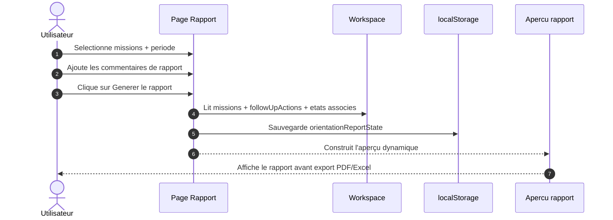

## 11. Detail mission et equipe

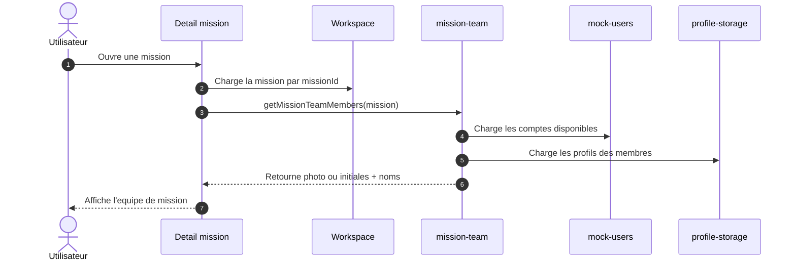

## 12. Synchronisation transversale des donnees

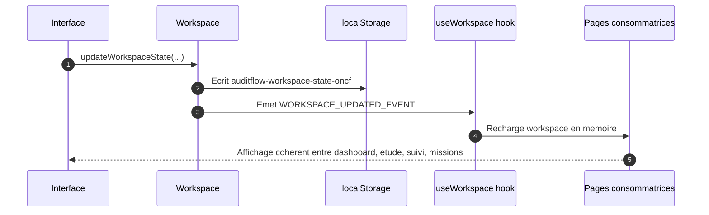

## Remarque importante

L'application actuelle fonctionne majoritairement sur un stockage `localStorage`
partage dans le navigateur. Les diagrammes ci-dessus decrivent donc le
fonctionnement reel actuel du projet visible, et non une architecture backend
de production avec une base de donnees centralisee.
